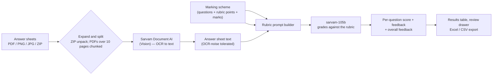

<!--
  README for Sarvam Check — built for a hackathon.
  TODO before submission:
   1. Replace "Built for <HACKATHON NAME>" below with the actual event.
   2. Add your screenshots into docs/screenshots/ using the exact file names
      listed in the Screenshots section (hero.png, 01-marking-scheme.png,
      02-upload.png, 03-results.png, 04-student-review.png). The image tags are
      already in place, so they appear as soon as the files exist.
-->

<div align="center">


# Sarvam Check

**Grade a whole stack of handwritten answer sheets — consistently, in minutes, not weekends.**

Upload the sheets, define your rubric once, and get per-question marks, partial credit and written feedback back as an Excel file.

Sarvam Vision reads the handwriting. `sarvam-105b` applies your marking scheme.

[](https://www.python.org/)
[](https://flask.palletsprojects.com/)
[](https://www.sarvam.ai/)
[-FF7A45)](https://www.sarvam.ai/)
[](#)

</div>

---

## The problem

Grading is the bottleneck of every classroom and every university department.

- A single TA can face **hundreds of handwritten answer sheets** per exam.
- Marking the same answer a hundred times produces **drift**: the 90th sheet is graded differently from the 10th.
- Rubric-based marking — awarding marks point-by-point instead of a holistic number — is the fair way to do it, but it is **far too slow to do by hand at scale**.
- The students who suffer most are in large, resource-stretched institutions where the TA-to-student ratio is brutal.

Sarvam Check exists to make **rubric-accurate grading of handwritten sheets** fast enough to actually use — while keeping the teacher in control of the rubric and the final call.

## What it does

A three-step wizard. No training data, no per-subject setup, no model fine-tuning.

**1. Marking scheme** — Build the rubric: add questions, the points each answer must contain, the marks per point, and optional grading notes ("allow half credit if the student mentions X"). Totals update live. Import/export the scheme as JSON and it is remembered in the browser.

**2. Upload** — Drag and drop PDFs, PNG/JPG scans, or a **ZIP of the whole class**. The file name becomes the student name. Preview any sheet in the browser before grading, or split a multi-page PDF so each page counts as a separate student.

**3. Results** — Watch live per-student progress, then click any row to open a review drawer showing the OCR text, per-question scores and the model's feedback. Export the whole class as **CSV or a styled Excel workbook**.

## Screenshots

<!-- Drop the images into docs/screenshots/ with these exact names and they render below. -->

**Build the rubric — questions, rubric points, marks and grading notes, with live totals.**


**Drop a ZIP of the whole class, or individual PDFs and scans. Preview before you grade.**


**Live results, then export the class to Excel or CSV in one click.**


**Open any student for the OCR text, per-question marks and written feedback.**


## How it works



The grading prompt is engineered to behave like a careful examiner, not a summariser:

- **OCR noise is never penalised** — spelling slips, broken lines and stray symbols from the scan are ignored; only the underlying content is judged.
- **Answers are matched to questions even when out of order or oddly labelled** (`Ans 2`, `2)`, `Q.2`, `II`) — labels first, then content.
- **Marks are awarded only for rubric points actually present**, with partial credit capped at the point's marks. Unattempted questions score zero. The model can never award more than the maximum.
- **Every score is clamped in code** to the question maximum before it reaches the sheet, so a hallucinated total cannot leak into your marks.
- **Low temperature (0.1)** and a strict JSON contract keep the same answer graded the same way across a batch.

## Features

| | |
|---|---|
| **Rubric-first grading** | Marks are tied to explicit points, not a single holistic number. |
| **Handwriting OCR** | Sarvam Document AI digitises scans and photos; PDFs over 10 pages are chunked automatically to respect the API limit. |
| **Batch, not one-by-one** | Drop a ZIP for the whole class. Parallel workers (configurable) grade several sheets at once with live progress and an ETA. |
| **Consistent & fair** | Low temperature + deterministic post-processing keep marking stable across hundreds of sheets. |
| **Teacher in the loop** | Review drawer shows the OCR text and feedback per question so you can override before exporting. |
| **Student name detection** | Reads the name/roll number off the sheet automatically, or falls back to the file name. |
| **Export-ready** | One-click CSV and a formatted `.xlsx` (frozen header, wrapped feedback) for your gradebook or SIS. |
| **Multilingual documents** | The OCR language is configurable, so sheets in Indian languages are first-class. |
| **Dry-check** | A one-click ping confirms your API key and model work before you start a real batch. |

## Tech stack

- **Backend:** Python, Flask
- **AI:** Sarvam Document AI (Vision) for OCR · `sarvam-105b` via Sarvam Chat Completions for rubric grading
- **Frontend:** Vanilla JavaScript, HTML/CSS (no build step), `pdf.js` for in-browser PDF preview
- **Export:** `openpyxl` (styled Excel) and the standard library's `csv`
- **Concurrency:** `ThreadPoolExecutor` for parallel submissions

## Getting started

**1. Clone and install**

```bash
git clone https://github.com/hidden-inference/Sarvam-Check.git
cd Sarvam-Check
python -m pip install -r requirements.txt
```

**2. Add your Sarvam API key**

```bash
cp .env.example .env
# then edit .env and set:
# SARVAM_API_KEY=your_sarvam_api_key_here
```

**3. Run**

```bash
python app.py
```

Open **http://localhost:5000** and start with step 1.

## Configuration

All configuration lives in `.env`:

| Variable | Default | Purpose |
|---|---|---|
| `SARVAM_API_KEY` | — | Your Sarvam API subscription key (**required**). |
| `SARVAM_CHAT_MODEL` | `sarvam-105b` | Chat model used for grading. |
| `DOC_LANGUAGE` | `en-IN` | Language hint for Document AI OCR. |
| `MAX_WORKERS` | `4` | How many answer sheets are graded in parallel. |

## Project structure

```
Sarvam-Check/
├── app.py              # Flask app: routes, upload expansion, job orchestration, Excel/CSV export
├── sarvam_client.py    # Sarvam Document AI (OCR) + chat grading, prompt & JSON normalisation
├── templates/
│   └── index.html      # Three-step wizard UI
├── static/
│   ├── app.js          # Wizard logic, live progress, review drawer, export
│   └── style.css       # Styling
├── requirements.txt
└── .env.example
```

## Roadmap

- [ ] Confidence scores per rubric point, so TAs know which sheets to re-check first.
- [ ] On-page annotation — overlay the awarded marks on the original scan.
- [ ] Question-paper auto-parsing to build the scheme from a PDF.
- [ ] Class analytics: per-question difficulty and common misconceptions.
- [ ] Pluggable rubric templates shared across a department.

## Built for

A hackathon. *(Replace with the event name and date.)*

## Acknowledgements

Built on **Sarvam AI** — [Document AI](https://www.sarvam.ai/) for handwriting OCR and `sarvam-105b` for grading.

---

<div align="center">
<sub>Rubric-accurate grading for the classrooms that need it most.</sub>
</div>
